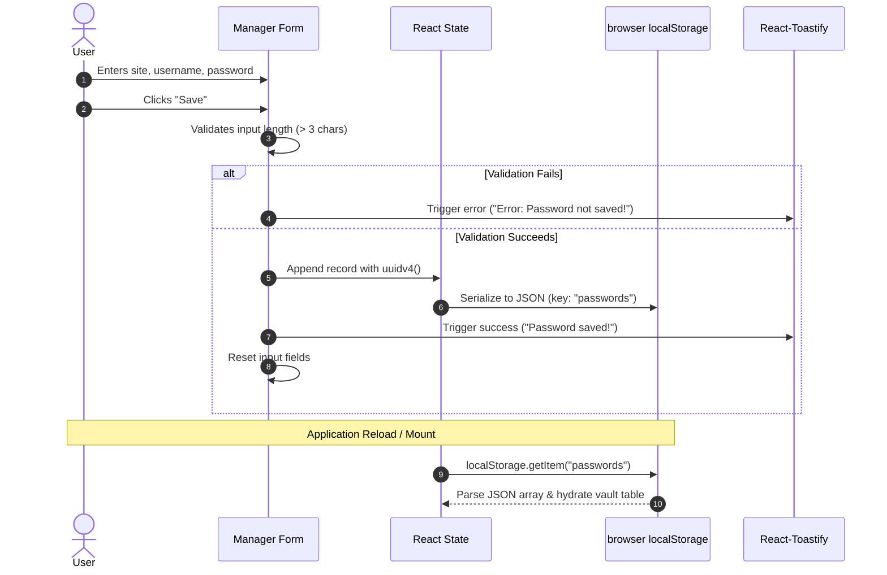

# <PassByte/> — Modern Web Password Manager

A lightweight, modern web-based password manager built with **React**, **Vite**, and **Tailwind CSS**. PassByte allows users to securely store, organize, edit, and copy credentials for websites and online services through a clean, responsive interface.

---

## Table of Contents

- [Overview](#overview)
- [Features](#features)
- [Preview & Screenshots](#preview--screenshots)
- [Technology Stack](#technology-stack)
- [Project Structure](#project-structure)
- [Prerequisites](#prerequisites)
- [Installation & Local Development](#installation--local-development)
- [Available Scripts](#available-scripts)
- [Version 1 — Browser-Based Storage](#version-1--browser-based-storage)
  - [Data Flow & Lifecycle](#data-flow--lifecycle)
  - [Current Limitations](#current-limitations)
- [Version 2 — MongoDB-Backed Storage (Roadmap)](#version-2--mongodb-backed-storage-roadmap)
  - [Architecture & Target Stack](#architecture--target-stack)
  - [Planned Features & Capabilities](#planned-features--capabilities)
- [Version 1 to Version 2 Migration](#version-1-to-version-2-migration)
- [Security & Privacy Notice](#security--privacy-notice)
- [Roadmap Checklist](#roadmap-checklist)
- [Contributing](#contributing)
- [License](#license)

---

## Overview

**PassByte** is designed to provide quick and accessible credential management directly in the browser. 

The current release (**Version 1**) operates entirely on the client side, storing user credentials locally using the browser's `localStorage` API. It features instant search-and-copy workflows, dynamic password visibility toggling, inline record editing, and real-time toast feedback.

A planned major release (**Version 2**) will introduce a dedicated **Node.js/Express** backend and **MongoDB** database to support multi-device synchronization, user accounts, and authenticated credential vaults.

---

## Features

All features listed below are verified and fully operational in the current **Version 1** codebase:

- **Add New Credentials**: Save website URLs, usernames, and passwords through a clean input form. Includes client-side field validation requiring at least 4 characters per field.
- **Credential Vault Table**: Displays all saved credentials in a structured, responsive table with dedicated columns for Site, Username, Password, and Actions.
- **Direct Website Navigation**: Website URLs in the vault render as live links that open directly in a new tab (`target="_blank"`).
- **One-Click Clipboard Copying**: Interactive copy icons alongside each site URL, username, and password allow instant copying to the system clipboard via the modern Clipboard API.
- **Password Visibility Toggle**: An interactive eye icon lets users toggle password input fields between masked (`type="password"`) and visible (`type="text"`) states before saving.
- **Inline Record Editing**: Click the edit action on any existing entry to populate the form for updating.
- **Delete Confirmation**: Deleting a record triggers a browser confirmation dialog to prevent accidental deletion.
- **Interactive Feedback (Toasts)**: Integrated notifications powered by `react-toastify` provide immediate feedback on actions (e.g., *"Copied to clipboard!"*, *"Password saved!"*, *"Password Deleted!"*, and validation error warnings).
- **Persistent Local Storage**: Credentials persist across browser sessions using `localStorage`.
- **Animated Micro-Interactions**: Animated icons powered by Lordicon provide visual feedback for saving, editing, copying, and deleting.
- **Branded Design System**: Customized purple theme (`bg-purple-200`, `text-purple-700`, `bg-purple-800`), custom `<PassByte/>` branding, and a custom SVG favicon.

---

## Preview & Screenshots

> [!NOTE]
> Screenshots will be added in upcoming documentation updates. To capture and preview the interface locally, follow the [Installation & Local Development](#installation--local-development) instructions below.

### Planned Asset Location

```
assets/
└── screenshots/
    ├── dashboard-preview.png
    ├── add-credential-flow.png
    └── mobile-responsive-view.png
```

---

## Technology Stack

### Frontend Core & Framework

| Technology | Version | Description |
| :--- | :--- | :--- |
| **React** | `^19.3.1` | Component-based UI library |
| **React DOM** | `^19.3.1` | DOM renderer for React |
| **JavaScript (ES Modules)** | ES2022+ | Modern client-side application logic |

### Build Tools & Bundler

| Tool | Version | Description |
| :--- | :--- | :--- |
| **Vite** | `^8.3.5` | Next-generation frontend tooling and dev server |
| **@vitejs/plugin-react** | `^6.1.2` | Official Vite plugin for React support |

### Styling & Design System

| Library | Version | Description |
| :--- | :--- | :--- |
| **Tailwind CSS** | `^3.4.19` | Utility-first CSS framework |
| **PostCSS** | `^8.5.32` | Tool for transforming styles with JS plugins |
| **Autoprefixer** | `^10.6.2` | PostCSS plugin to parse CSS and add vendor prefixes |

### UI Utilities & Libraries

| Library | Version | Description |
| :--- | :--- | :--- |
| **React-Toastify** | `^11.2.0` | Custom toast notification system |
| **UUID** | `^14.0.3` | Generates cryptographically strong unique record identifiers (`uuidv4`) |
| **Lordicon** | CDN Script | Interactive animated JSON icons loaded via CDN script |

### Code Quality & Linting

| Tool | Version | Description |
| :--- | :--- | :--- |
| **ESLint** | `^10.13.0` | Pluggable JavaScript linter with flat configuration |
| **eslint-plugin-react-hooks** | `^7.1.1` | Enforces React Hooks rules |
| **eslint-plugin-react-refresh** | `^0.5.7` | Validates components for Fast Refresh |

---

## Project Structure

```
PassByte/
├── index.html              # Vite HTML entry point (Lordicon CDN, metadata, favicon)
├── package.json            # Project dependencies, metadata, and npm scripts
├── package-lock.json       # Exact dependency lockfile
├── postcss.config.js       # PostCSS plugins (Tailwind CSS, Autoprefixer)
├── tailwind.config.js      # Tailwind CSS template content paths and theme extensions
├── vite.config.js          # Vite build and plugin configuration
├── eslint.config.js        # ESLint flat configuration file
├── public/                 # Static assets served directly at root
│   ├── favicon.svg         # Custom PassByte Padlock-P brand favicon
│   ├── icons.svg           # Scalable SVG sprite asset definitions
│   └── icons/              # Static icon assets (eye, eyecross, github, heart)
└── src/                    # Application source code
    ├── main.jsx            # Application mount point (React 19 createRoot)
    ├── App.jsx             # Top-level shell layout (Navbar, Manager, Footer)
    ├── App.css             # Component-level styles (currently empty)
    ├── index.css           # Global Tailwind directives & custom utility classes
    ├── assets/             # Internal project media assets
    └── components/         # Reusable React components
        ├── Navbar.jsx      # Top navigation header with brand logo & GitHub link
        ├── Manager.jsx     # Core password management dashboard, state & forms
        └── Footer.jsx      # Application footer with branding and credits
```

### Component Breakdown

- **`src/components/Manager.jsx`**: The core component managing form input state (`site`, `username`, `password`), password list array state, `localStorage` read/write operations, clipboard actions, record editing, and toast alerts.
- **`src/components/Navbar.jsx`**: Renders the header containing the `<PassByte/>` brand mark and a quick-link button to GitHub.
- **`src/components/Footer.jsx`**: Displays bottom branding, developer attribution, and matching purple styling.
- **`src/index.css`**: Defines Tailwind layer directives and reusable custom container styles (`.mycontainer`).

---

## Prerequisites

Before running PassByte locally, ensure you have the following installed:

- **Node.js**: `v18.0.0` or higher (recommended: `v20.x` LTS or `v22.x` LTS)
- **npm**: `v9.0.0` or higher (comes bundled with Node.js)
- A modern desktop web browser (Chrome, Firefox, Safari, Edge) with JavaScript and `localStorage` enabled.

---

## Installation & Local Development

1. **Clone the repository**:

   ```bash
   git clone https://github.com/Divyam16choubey/PassByte.git
   cd PassByte
   ```

2. **Install project dependencies**:

   ```bash
   npm install
   ```

3. **Start the local development server**:

   ```bash
   npm run dev
   ```

4. **Access the application**:

   Open your browser and navigate to the local development URL printed in the terminal (typically `http://localhost:5173`):

   ```
     VITE v8.3.5  ready in 250 ms

     ➜  Local:   http://localhost:5173/
     ➜  Network: use --host to expose
   ```

---

## Available Scripts

The following scripts are defined in `package.json`:

| Command | Description |
| :--- | :--- |
| `npm run dev` | Starts the Vite development server with Hot Module Replacement (HMR). |
| `npm run build` | Compiles and bundles production-ready assets into the `dist/` directory. |
| `npm run preview` | Spins up a local static server to preview the production build from `dist/`. |
| `npm run lint` | Analyzes code quality using ESLint based on project rules. |

---

## Version 1 — Browser-Based Storage

### Data Flow & Lifecycle

PassByte Version 1 is a client-side single-page application. Its operational lifecycle works as follows:



1. **Input & Validation**: The user inputs credentials into the form. Upon clicking "Save", inputs are validated to ensure `site`, `username`, and `password` each exceed 3 characters.
2. **Identification**: A unique identifier is generated using `uuidv4()` and attached to the record object:
   ```json
   {
     "id": "e7b1a2c3-4d5e-6f7a-8b9c-0d1e2f3a4b5c",
     "site": "https://example.com",
     "username": "user@example.com",
     "password": "sample-password"
   }
   ```
3. **Storage**: The updated array is serialized to a JSON string and written to browser storage under the key `"passwords"`.
4. **Hydration**: On initial component mount (`useEffect`), the app reads the `"passwords"` key, parses the JSON string, and hydrates the table state.
5. **Editing**: Clicking the edit icon populates the form with the chosen record's values and temporarily removes the old record from state so the updated entry can be saved.
6. **Deletion**: Clicking the delete icon prompts the user for confirmation. Upon approval, the item is removed from state and updated in `localStorage`.

### Current Limitations

> [!WARNING]
> Please review these limitations before using Version 1 for sensitive accounts:

- **Browser-Specific Storage**: Records saved in one browser or device do not synchronize with other browsers, devices, or private/incognito windows.
- **Data Volatility**: Clearing browser cookies and site data, or using browser cleaning extensions, permanently deletes all stored passwords.
- **No Native Encryption**: Version 1 stores records in plaintext JSON in the browser's `localStorage`. Anyone with physical access to your device or browser Developer Tools can read the contents.
- **Client Script Exposure**: Data stored in `localStorage` is accessible to scripts executing within the same origin.

---

## Version 2 — MongoDB-Backed Storage (Roadmap)

>Version 2 represents the next evolutionary phase of PassByte, transitioning the application from a local browser utility into a full-stack, cloud-synchronized credential manager.

### Architecture & Target Stack

```
┌─────────────────────────────────┐
│     PassByte React Client       │  (Vite + React 19 + Tailwind CSS)
└────────────────┬────────────────┘
                 │ HTTPS / REST API (JSON)
                 ▼
┌─────────────────────────────────┐
│       Node.js + Express         │  (Authentication, Validation, Routing)
└────────────────┬────────────────┘
                 │ Mongoose ODM / Driver (TLS)
                 ▼
┌─────────────────────────────────┐
│        MongoDB Database         │  (Encrypted User Vaults & Accounts)
└─────────────────────────────────┘
```

- **Frontend**: Existing React + Vite application updated with authentication views and API service modules.
- **Backend**: Node.js + Express REST API providing secure endpoints.
- **Database**: MongoDB (Atlas or self-hosted) with Mongoose schemas.
- **Communication Protocol**: REST over HTTPS in production.

### Planned Features & Capabilities

1. **Remote Cloud Persistence**: Password records will be stored in a centralized MongoDB database, enabling access across multiple devices and browsers.
2. **User Authentication & Authorization**: Introduce secure user registration and login (e.g., JWT-based or session-based authentication with bcrypt password hashing).
3. **Isolated User Vaults**: Associate credentials with authenticated user IDs so users can only view, create, edit, or delete their own vault items.
4. **Server-Side Validation**: Implement robust server-side schema validation (e.g., Zod or Joi) to guarantee data integrity independently of client-side checks.
5. **Client-Side / Vault Encryption**: Implement authenticated encryption (such as AES-256-GCM) with master-key derivation (PBKDF2 / Argon2), ensuring stored credentials cannot be read by database administrators or compromised in transit.
6. **Configuration via Environment Variables**: Manage sensitive settings, database connection URIs (`MONGODB_URI`), and signing secrets through `.env` files.
7. **Security Hardening**: Enforce Cross-Origin Resource Sharing (CORS) whitelisting, HTTP security headers (Helmet), request rate limiting, and input sanitization.
8. **Automated Testing Suite**: Introduce unit and integration tests covering API endpoints, authorization checks, and database models.

---

## Version 1 to Version 2 Migration

When Version 2 is released, an automated migration process will help users transition their existing records from browser `localStorage` to their new authenticated MongoDB vault.

### Planned Migration Principles

- **Explicit User Consent**: Migration will require the user to log in and explicitly authorize the transfer of their local records.
- **Pre-Migration Validation**: Locally stored records will be validated for correct structure before transmission.
- **Deduplication**: The migration service will verify existing cloud records to prevent accidental duplicate entries.
- **Safe Transmission**: Vault items will be encrypted and transmitted securely over TLS without exposing credentials in server logs.
- **Non-Destructive Process**: Local records in `localStorage` will remain intact until the cloud import is verified and the user confirms completion.
- **Error Recovery**: In the event of network disruption, the migration tool will report exact status and allow users to retry safely without data loss.

---

## Security & Privacy Notice

### Current Version (v1.x)
- PassByte Version 1 is intended for personal utility, development demonstration, and educational purposes.
- Credentials are saved in **unencrypted plaintext** within browser `localStorage`.
- **Do not use Version 1 to store mission-critical passwords, financial details, or sensitive production credentials.**

### Future Version (v2.x)
- Version 2 will require thorough cryptographic review, secure authentication, and end-to-end encryption before being suitable for production credentials.

---


## Contributing

Contributions, suggestions, and feedback are welcome! To contribute to PassByte:

1. **Fork the repository** on GitHub.
2. **Create a feature branch**:
   ```bash
   git checkout -b feature/your-feature-name
   ```
3. **Commit your changes**:
   ```bash
   git commit -m "Add: your feature description"
   ```
4. **Push to your branch**:
   ```bash
   git push origin feature/your-feature-name
   ```
5. **Open a Pull Request** describing your changes and testing steps.

---

## License

No license has been specified for this project yet.